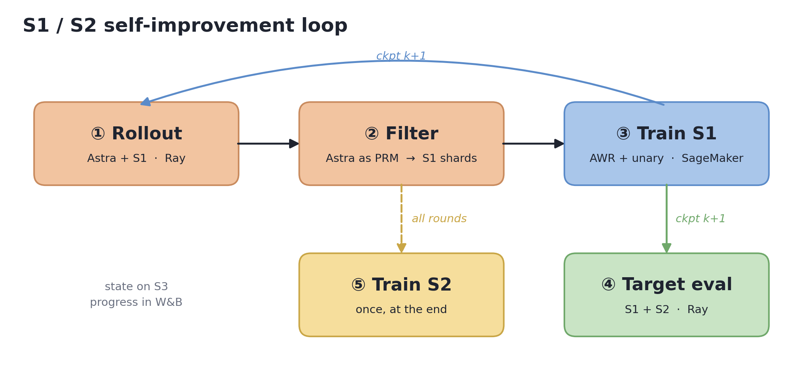

# selfimprove: the S1 / S2 self-improvement loop



Each round *k* runs these stages:

1. **Rollout.** Astra (planner and judge) runs with our S1 at checkpoint *k* in HexaShell, on a Ray cluster. The rollouts cover RoboCasa's pretrain300 tasks whose demos replay to success at least 80% of the time (287 tasks), with fresh seeds each round in the pretrain kitchens, disjoint from the target split.
2. **Filter.** Astra acts as a process reward model and scores every segment from very good to very bad. Good S1 segments become positives (AWR), bad ones become negatives (unary), and harness corrections become DAgger positives. The result is written as S1 shards in openpi's exact format.
3. **Train.** S1 is continue-trained on SageMaker, starting from checkpoint *k*, which is also the frozen reference: `L = AWR·ℓθ + λ₊·unary₊ + λ₋·unary₋`. This produces checkpoint *k+1*.
4. **Evaluate.** Checkpoint *k+1* plus our S2 is evaluated on the target split (1500 episodes, the protocol of the 53.7% baseline). This runs on a second Ray cluster while round *k+1* rolls out.

S2 is trained once, at the end, on all rounds' turns. The cheap-LLM language annotation for it is the next piece to build.

## The repos involved

| Repo (branch) | What changed |
|---|---|
| `~/selfimprove` (new) | This loop: config, scheduler, Ray drivers and nodes, PRM and shard writer, launchers, W&B, cluster configs, tests |
| `~/HexaShell-s1` (`self-improve`, from `s1-tool`) | RoboCasa protocol knows the pretrain300 tasks (`pretrain_tasks.json`). The trajectory record also keeps MuJoCo's full state per step plus `model.xml.gz` and `scene.json`, so episodes can be replayed and re-rendered. The official score still counts the 50 target tasks only. |
| `~/openpi-si` (worktree of `~/openpi`, branch `self-improve`) | `TrainConfig.si` objective (AWR + unary ±, frozen reference in the train state). `si_label` / `si_weight` added to the Observation. `dir*K` shard repetition. `Policy.score` / `ScoringPolicy` (the S1 server answers `{"__op__": "score"}` with per-chunk surrogate losses). SageMaker `ROBOCASA_EXTRA_SHARDS` and `training.env`. W&B group and tags. Tests in `scripts/train_si_test.py`. |

Your working copy `~/openpi` (branch `robocasa`) was not touched.

## S3 layout (`s3://tri-ml-datasets-uw2/yinpeidai/self_improve/<exp>/`)

```
config.yaml  state.json
iter_00/rollout/<task>/<seed>/        HexaShell record: result.json, events.jsonl (every turn: thought, judge, subgoal),
                                      transcript.json, trajectory/ (every control step: 3 cams @256, raw16, action,
                                      gripper, camera poses, MuJoCo state; model.xml.gz, scene.json), chunk_scores.jsonl
                                      (S1's surrogate loss per executed chunk), rollout.json (node, ckpt, cost, timings)
iter_00/rollout/_plan.json _status.json _DONE
iter_00/s1_training_shard/            shards/*.tar + manifest.jsonl + meta.json + segments.jsonl (every segment, score, use)
iter_00/s1_ckpts/                     SageMaker run; _FINAL names the checkpoint the next round uses
iter_00/eval/target/<task>/<episode>/ combined_eval episode folders; summary.json, _status.json, _DONE
s2_training_shard/  s2_ckpts/         (S2: once, at the end)
```

## Commands

The environment is `uv venv --python 3.11 .venv && uv pip install -e ".[dev]"`. Every command takes `--config configs/<exp>.yaml` and `--set key.sub=value`.

```bash
selfimprove run    --config configs/si_v1.yaml      # the loop (tmux); `tick` = one pass, `status` = state
selfimprove rollout --iteration 0 --ckpt <s1 ckpt> [--local] [--limit N]
selfimprove preprocess --iteration 0
selfimprove train  --iteration 0 --ckpt <s1 ckpt> [--dry-run]
selfimprove eval   --iteration 0 --ckpt <s1 ckpt> [--local] [--tasks CloseFridge --limit 1]
selfimprove node   --ckpt <s1 ckpt> --task CloseCabinet --seed 100001 [--upload]   # one episode, no Ray
selfimprove mock-wandb --exp-id mock_demo                                            # a simulated experiment
.venv/bin/python -m pytest -q tests
```

### Recorded episodes as starting states (split `demo`)

Every development episode starts exactly as one of RoboCasa's recorded pretrain-split episodes: the same kitchen
layout and style, fixtures, objects and robot pose. No layout outside the datasets is used.
- **Extraction.** `scripts/extract_sim_states.py` walks the downloaded LeRobot datasets (`~/data/robocasa_dataset/v1.0`).
  Each `extras/episode_N/` gives its first MuJoCo state (`states.npz[0]`), its scene (`model.xml.gz`) and its `ep_meta.json`.
  These go into one npz per episode under `s3://tri-ml-datasets-uw2/yinpeidai/self_improve/sim_states/v1.0/`:
  - `pretrain/<Task>/`: 300 tasks, 32,043 episodes. This is what development uses.
  - `target/<Task>/`: 50 tasks, 25,307 episodes, for evaluation only.
  - `<Task>/index.json`, `manifest.json` and `development_120.json` describe them.
- **Starting an episode.** HexaShell's split `demo` (`$HEXASHELL_ROBOCASA_DEMOS`) starts seed n from the task's n-th
  recording. It uses RoboCasa's `reset_to`, the same way openpi's `combined_eval.py` resets the target protocol.
- **Planning.** Each round plays `seeds_per_task` (30) of each task's recordings, drawn at random. A recording is never
  played twice in one experiment. The node checks that every episode started the recording the plan names.
- **Comparison.** `scripts/compare_demo_start.py <exp>` puts each recording's first video frame next to HexaShell's start
  pictures.
- **Older base.** The datasets' robot has the older mobile base, whose forward joint runs along y. HexaShell's base
  controller handles it.

### The rollout tasks and the prompt A/B

**Development tasks (the default, `rollout.tasks: rollout`).** These are 120 tasks in `assets/rollout_tasks.json` (`scripts/rollout_tasks.py`,
`docs/rollout_tasks.md`):
- the 18 atomic_seen and 16 composite_seen target tasks;
- all 44 pretrain atomic tasks;
- 42 of the 64 pretrain composite tasks of rule A. The 22 weakest in the prompt A/B are dropped; `docs/ab108_ranking.md` has the full ranking.

All of them run in RoboCasa's pretrain kitchens with the pretrain objects. The **16 composite_unseen tasks are held out**. They are never in a training
rollout: `plan_round` refuses them, and only a `target50` check round may play them. They are never in S1 or S2 training data either: the
preprocessing stage leaves them out, and the shard and S2 builders raise on them.

`scripts/select_tasks.py` (rule A) writes `assets/selected_tasks.json` and `docs/task_selection.md`: 108 tasks, i.e. every pretrain
atomic task plus every pretrain composite task of the RoboCasa families of the 16 composite_unseen target tasks, without
replay-failed tasks and without the 50 target tasks. `rollout.tasks: selected` plays them. `rollout.seed_key` lets two
experiments draw the same seeds.

Each of these tasks has its own notes in HexaShell-s1: `skills/robocasa/<Task>.md` and System1's step table
`skills/robocasa_s1/<Task>.md`. The A/B tests whether they help. Both arms run with the same 5 seeds per task, 8 GPUs each,
on one rollout cluster:

```bash
cluster/bring_up.sh scale rollout 0                     # the head (workers come with the drivers' demand)
scripts/cluster_rollout.sh ab108_with    0 <270k ckpt> --config configs/ab108_with.yaml      # skills + s1_skills on
scripts/cluster_rollout.sh ab108_without 0 <270k ckpt> --config configs/ab108_without.yaml   # the generic card
.venv/bin/python scripts/ab_compare.py ab108_with ab108_without --out docs/ab108.md          # per task / family / kind
```

## Going live (each step needs your go-ahead: they start paid resources)

1. **Bundle.** `bash cluster/make_bundle.sh` puts RoboCasa's assets (about 25 GB), SAM3, the openpi assets and the eval simulator env on S3 for the nodes.
2. **Training image.** The first `selfimprove train` without `train.image_tag` builds and pushes the openpi-si image. After that, pin the tag in the config.
3. **Clusters.** Run `cluster/bring_up.sh validate rollout` and `cluster/bring_up.sh validate eval`. Each validates one g6e worker end to end (`selfimprove.cluster_check`) before any scaling, as in Kushal's runbook. Optionally bake an AMI from a validated node.
4. **Run the loop.** `selfimprove run --config configs/si_v1.yaml`. Progress is visible in W&B (project `s1s2-self-improve`, one group per experiment) and with `selfimprove status`.

## The scheduler

The scheduler is a deterministic daemon (`selfimprove run`). It ticks every `cluster.poll_s`, and every decision it makes reads S3, so it can be killed and restarted at any time.

To have an agent watch over it as well, run in a Claude Code session in this repo:

```
/loop 30m run `selfimprove status --config configs/si_v1.yaml`; if a stage failed, stalled (no _status update for an hour)
or a round's success / S1 share / eval moved the wrong way, read its logs on S3 and in ~/selfimprove_work and report
```

## Key knobs (`configs/default.yaml`)

- **Rollout.** `rollout.seeds_per_task` (10), `pilot_seeds_per_task` (2 in round 0), `min_replay_success` (0.8). Per-GPU sizing: `slots_per_gpu` (4) and `s1_mem_gb` (20).
- **PRM and selection.** `filter.*`: advantages per level, `awr_beta`, which levels become positives or negatives, `slow_factor`.
- **Training.** `train.steps` (10k), `new_data_fraction` (0.5 of the batches), `train.si.{lambda,beta}_{pos,neg}`, `instance_count` (2 p5).
- **Eval.** `eval.*`: the same flags as the fleet's 53.7% arm. `baseline` is drawn as the 0-th point in W&B.

## Verified on this machine (2026-11-19)

- **One episode on the node, no Ray.** Real Astra + S1 + RoboCasa on CloseCabinet, a pretrain300 task in a pretrain kitchen: success. All 17 chunks were scored and the episode uploaded to S3.
- **Local Ray round.** Plan → node → 2 episodes → scores → S3 → `_status`/`_DONE` → W&B. Both episodes succeeded. S1's surrogate loss was 0.041 on its own chunks and 0.73 on the harness's corrections.
- **Preprocessing from S3.** 11 segments became 509 samples. openpi's own loader reads them with the checkpoint's config, including its lean-state recompute-equals-baked assertion. The math also matches RoboAnnotator's (`tests/test_s1_parity.py`).
- **Real 3B checkpoint, 3 CPU training steps with the frozen reference.** `si/loss_pos` = 0.6931 = log 2 at step 0, so ℓθ and ℓref pair exactly. The base and rollout shards were mixed with `*K`.
- **One target-split episode.** Run through the Ray eval node: S1 server + S2 vLLM (Docker) + `combined_eval.py` with the fleet's flags. CloseFridge target episode 0 was solved by our S1 + S2 (`env_success`) and uploaded to `iter_00/eval/target/` with `summary.json`.
- **SageMaker submission (`--dry-run`).** Queue, channels, flags, checkpoint path and W&B all resolve correctly.
- **Scheduler.** The state machine runs over 2 iterations with fakes, including a failed training retried and then stopped (`tests/test_scheduler.py`). Dry-run ticks on the real S3 state also work.
- **W&B.** The project exists, with the sanity runs and a mock experiment (`mock_demo`, tagged `mock`).

- **Ray cluster on EC2 (rollout), 2026-11-19.** `cluster/bring_up.sh` brought up an m5.2xlarge head and 2 g6e.4xlarge workers (L40S). Each worker ran an S1 server with the checkpoint from S3, SAM3 from `self_improve/models/` and 4 simulators. 8 Astra + S1 episodes (CloseCabinet, OpenDrawer, TurnOnSinkFaucet, PrepareCoffee × 2 seeds) all succeeded, with S1 executing 92% of the steps. The round took 6.5 min at 75 episodes/hour on 2 nodes. Surrogate loss was 0.020 on S1's chunks and 0.41 on the harness's. The cluster was then taken down.

- **Ray clusters in us-west-2, 2026-11-19.** The `si_v1` pilot rollout ran on 8 g6e workers, and the eval cluster was checked end to end. 4 of 4 CloseFridge target episodes were solved by S1 + S2 through `selfimprove.eval.target` on a g6e node: the S1 server and the S2 vLLM in Docker came from S3, and the episodes were uploaded to `iter_00/eval/target/`.

- **Harness + S1 on Ray, 2026-11-21.** `harness_check_full2` covered the 50 target tasks × seeds 0-2 in pretrain50 kitchens: 92.0%, against 90.7% for the same episodes run locally, in 25.6 min on 8 GPUs. (Raw records deleted 2026-11-24.)
- **Prompt A/B on the 108 selected tasks, 2026-11-22.** 540 paired episodes, 5 pretrain seeds per task. With the task notes and System1 tables: 88.1%. With the generic card: 83.9%. Composite tasks went from 80.6% to 87.5% (McNemar p = 0.006); atomic tasks stayed at about 89%. Each arm took about 1 h on 8 GPUs. See `docs/ab108_findings.md` (raw records deleted 2026-11-24).

## Cluster notes

- The clusters run in **us-west-2**: the bucket's region, with VPC `ml-west2-vpc` and `sagemaker-sg`, which has the same rule as us-east-1's "ray" group. us-east-1's G-instance vCPU quota (1440) is often fully used by other clusters in the account, and that variant is kept in `cluster/us-east-1/`.
- Worker sizes are 1-GPU g6e only. With a 4-GPU size available, the autoscaler kept retrying it whenever it had no capacity.

- g6e.4xlarge capacity in us-east-1 comes and goes. The workers list four g6e sizes over the VPC's subnets in 1a–1d, and the autoscaler falls back to whichever has capacity.
- Secrets never go through Ray. Runtime envs and task arguments appear in Ray's errors and dashboard. Instead, `ray up` copies 0600 key files from `~/.config/selfimprove/secrets/` to `~/.config/hexashell/api-key` and `~/.config/selfimprove/wandb-api-key` on the nodes, over SSH. HexaShell reads its key file natively.
- `ray up` re-syncs file mounts to the head only. Workers that are already up need `scp` (see `CLUSTER_RUNBOOK` fault 8 in Kushal's repo).
- Synced code must not contain dangling symlinks: a node's setup fails on them, and the autoscaler then replaces the node forever. `config/env.sh` is excluded, and `openpi-si/assets` is a real copy.

## Not yet verified or built

- An AMI baked from a validated node. Without one, a fresh node takes about 8 minutes to set up.
- A real SageMaker training round.
- The full 1500-episode eval on the cluster (one episode verified locally).
- S2: the cheap-LLM annotation (`selfimprove/s2/build.py:annotate`) and Qwen3-VL shard writing. The raw per-turn rows and clips are built now.
